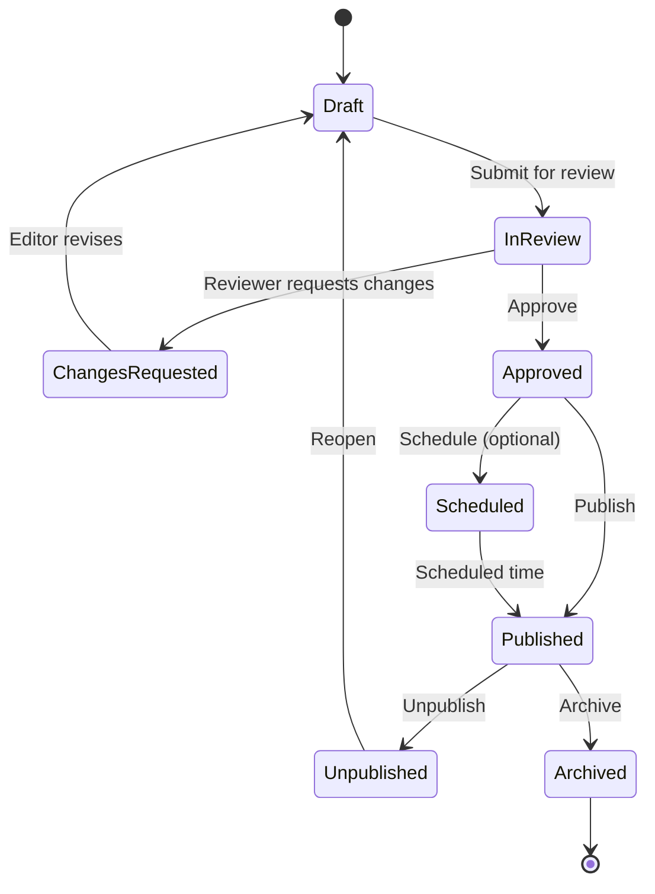

# Content Architecture

**Status:** Proposed domain model; taxonomy awaits editorial approval  
**Owner:** Editorial Lead (TBD)  
**Related:** PRD §2, §5–§6; PDD §7–§8; SRS §5–§8; DEC-003, DEC-004, DEC-014, DEC-015

## 1. Purpose

Menetapkan bagaimana Mahira mengelompokkan, menghubungkan, menerjemahkan, menerbitkan, dan mendistribusikan konten. Dokumen ini mendefinisikan konsep editorial; tipe dan field database final berada di `DATA-MODEL.md`.

## 2. Core content domains

| Concept | Definition | Example | Proposed relation |
|---|---|---|---|
| Publication | Karya utama berbasis riset/analisis yang diterbitkan organisasi. | Research report, policy brief. | Has authors, type, desk/topic, assets, translation group. |
| Publication Type | Format/genre editorial. | Report, policy brief, working paper, commentary. | One type per publication initially; revisit if multiple classification needed. |
| Research Desk | Area kerja/program riset organisasi yang mengelompokkan portofolio isu. | Economy & Development. | Many publications may belong to one or more desks; final cardinality TBD. |
| Topic | Isu/subjek spesifik untuk discovery lintas desk/type. | Food security, fiscal policy. | Many-to-many with publications proposed. |
| Tag | Label granular dan fleksibel untuk pencarian/editorial curation. | APBN, regional policy. | Many-to-many; optional and controlled. |
| Author | Person credited as author/editor/contributor. | Named researcher. | Many-to-many with publications; role/sequence on relation. |
| Publication Asset | File or resource attached to publication. | Cover, PDF, appendix, dataset. | Many assets per publication; individual access classification proposed. |
| Learning Resource | Educational item in Learning Hub. | Video, playlist, reading list, external resource. | May relate to topic/desk/publication. |
| Static Page | Institutional information page. | About, contact, policy. | Localized and published through CMS. |
| Event | Event information, if approved in scope. | Seminar or webinar. | P2 / optional per PRD. |

## 3. Taxonomy rules

### 3.1 Do not collapse different concepts

- **Desk** is an organizational/research portfolio grouping.
- **Topic** is a subject classification that may cross desks.
- **Publication Type** describes the editorial form or genre, not its subject.
- **Tag** is a lightweight additional descriptor and must not replace the controlled taxonomy.
- **Category** should not be introduced as a generic catch-all until a concrete use case and distinction from Desk/Topic/Type are documented.

### 3.2 Proposed relationship model

- Publication ↔ Author: many-to-many through a relation carrying author order and contribution role.
- Publication ↔ Topic: many-to-many.
- Publication → Publication Type: many-to-one initially.
- Publication ↔ Desk: many-to-many if cross-desk work is a real editorial case; otherwise many-to-one. Confirm with sample records.
- Publication ↔ Tag: many-to-many, optional.
- Publication → Publication Asset: one-to-many.
- Publication ↔ Translation group: links language variants according to DEC-004.
- Learning Resource ↔ Topic/Desk/Publication: optional relationships determined by editorial use.

## 4. Proposed content lifecycle

This is a proposed workflow. PRD D-05 is open; confirm whether review and scheduled publishing are required. A CMS status must not be conflated with access level or translation completeness.

## 5. Publication minimum content contract

A publication should not be publishable until required values are available for its locale. Proposed minimum:

- Title.
- Locale and translation identity/group (per selected model).
- Stable slug.
- Publication type.
- Short summary/abstract.
- At least one credited author or an explicitly approved institutional author.
- Published date (and optionally updated date).
- At least one relevant desk/topic according to final taxonomy.
- Access level.
- Public metadata visibility setting (default public).
- At least one asset or external destination if download is a promised action.
- SEO title/description or deterministic fallback from approved fields.
- Rights/credit information for assets where applicable.

Required word counts, abstract limits, citation style, DOI/ISBN fields, and license fields must be set by Editorial Lead; they are not defined by current baseline.

## 6. Asset classification

| Kind | Example | Typical visibility |
|---|---|---|
| Cover image | Cover artwork | Public |
| Preview/excerpt | Sample pages or executive summary PDF | Public or registered; editorial decision |
| Full publication | Complete report PDF | Follows publication access by default |
| Appendix | Supplemental document | May differ; explicit asset-level rule required |
| Dataset | CSV/XLSX/ZIP | Often restricted or public per license/policy |
| Supporting link | External source/resource | External access policy; never assume protected by Mahira |

An asset must have title/label, kind, MIME type, size, storage provider/bucket reference, opaque object key, checksum if feasible, locale where relevant, access classification, upload status, and rights metadata. Private object key must never appear in public page data.

## 7. Translation and editorial completeness

Track translation relationship and status explicitly. Proposed statuses: `not_started`, `in_progress`, `in_review`, `published`, `not_required`. Do not infer translation availability from a non-empty field alone. A translation can be published independently only if editorial policy approves.

Translation requirements:

- Preserve semantic equivalence where the content is a translation; mark adaptation where material changes.
- Each locale has reviewed title, summary, body, slug, SEO metadata, and assets as applicable.
- Locale switch maps to matching translation when available; otherwise a defined fallback destination/message is used.
- Hreflang/canonical must reflect published equivalents only.

## 8. Editorial ownership and quality

Each content type must have an owner, authoring role, reviewer/approver role, required metadata, update policy, retention/archival rule, and correction policy. These are organizational decisions and must be confirmed in the Editorial Workflow and Editorial Guide.

## 9. Seed taxonomy and migration

Do not hardcode sample desks/types as production taxonomy. Create a stakeholder workshop using actual intended research areas and 10–20 representative publications (if available). Test whether users can classify and find each item consistently. Assign stable IDs; labels/slugs can evolve through redirects without changing identity.

## 10. Out of scope until approved

LMS course hierarchy, assessments, certificates, contributor submission portal, peer-review management, DOI registration, dataset repository, and automated content licensing are not part of the current confirmed MVP.
