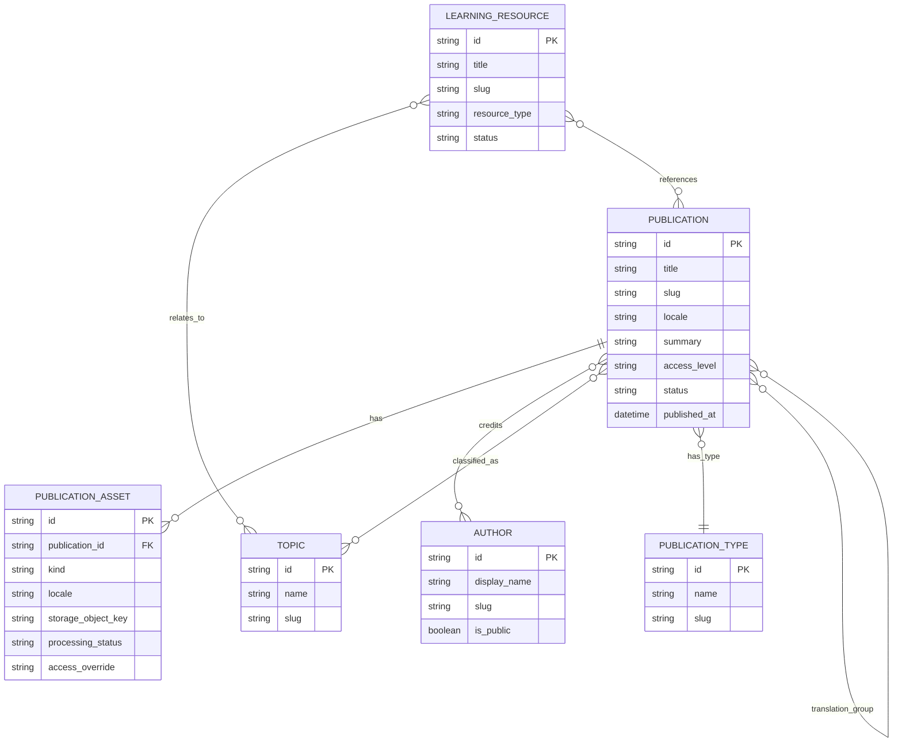
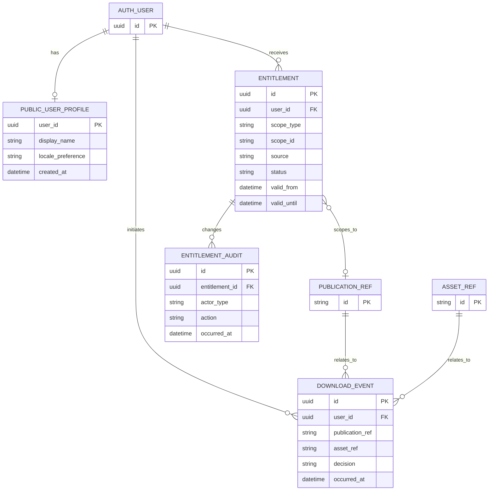

# Entity Relationship Diagram (ERD)

**Status:** Logical proposal. Cardinality and localization implementation require DEC-003/004/007/011.  
**Source:** `DATA-MODEL.md` is the field-level authority.

## 1. Editorial and content domain (conceptual)

The diagram uses direct many-to-many labels for readability. Actual Payload implementation may generate join tables, arrays, or relation collections depending on the selected adapter and relationship configuration. If author order or contribution role is needed, use an explicit relation collection rather than an unqualified many-to-many relation.

## 2. Public account and entitlement domain

`PUBLICATION_REF` and `ASSET_REF` are conceptual references across domain ownership, not necessarily foreign-key tables in Supabase application schema. Do not create cross-owner hard foreign keys unless migration and lifecycle ownership are designed and tested.

## 3. Ownership overlay

- Payload-owned: Publication, PublicationAsset (pending decision), Author, Topic, PublicationType, LearningResource, Page, StaffUser.
- Supabase Auth-owned: Auth user identity.
- App schema-owned: PublicUserProfile, Entitlement, audit/event tables, future payment tables.
- Object storage-owned: binary object; database holds metadata and opaque object key.

## 4. Decisions that can change this ERD

DEC-003 taxonomy/cardinality; DEC-004 translation model; DEC-007 schema ownership; DEC-009 staff access; DEC-011 asset-level access; DEC-012 asset metadata/storage adapter. Update this diagram when an ADR is Accepted.
