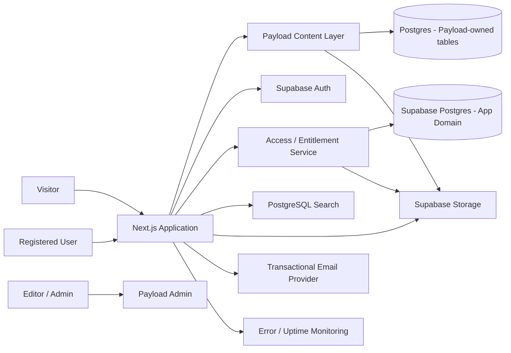

# System Architecture

**Status:** Proposed logical architecture  
**Related baseline:** PRD §1–§11; SRS §2, §4, §8, §11–§13  
**Related decisions:** DEC-006–DEC-017

## 1. Purpose and scope

Dokumen ini menggambarkan logical architecture platform Mahira: public publication experience, editorial CMS, public-user account, content-access control, Learning Hub, storage, search, dan operational services. Ini bukan deployment diagram final dan tidak mengklaim integrasi telah divalidasi.

## 2. Architectural principles

1. **Publication-first:** publikasi adalah domain produk utama.
2. **Public discovery, controlled access:** metadata dan ringkasan dapat ditemukan secara publik; file dilindungi berdasarkan access policy.
3. **Server authority:** keputusan role, entitlement, akses aset, dan operasi privileged dibuat di server.
4. **Explicit ownership:** setiap data entity mempunyai satu owner dan satu migration authority.
5. **One application initially:** satu Next.js application dengan domain boundaries; split hanya karena alasan terukur.
6. **Content portability:** file berada di object storage, metadata dan file reference terpisah.
7. **Localization-aware:** UI, URL, content, search, SEO, dan editorial status memperhatikan locale.
8. **Testable by design:** setiap policy kritis mempunyai unit/integration/E2E verification.
9. **Least privilege:** service credentials dan staff role mempunyai scope minimal.
10. **No speculative expansion:** payment, LMS, analytics kompleks dan external search tidak diimplementasikan sebelum kebutuhan/trigger disetujui.

## 3. Logical context

Logical diagram; actual connection topology, schema separation, and storage adapter depend on ADR/spike outcomes.

## 4. Domain boundaries

| Domain | Primary responsibility | Proposed owner | Must not own |
|---|---|---|---|
| Public experience | Render homepage, publication directory/detail, about, learning directory. | Next.js public routes | Authorization truth or content mutation policy. |
| Editorial | Manage publication metadata, authors, taxonomy, pages, learning resources, versions and workflow. | Payload CMS | Public-user entitlement records. |
| Public identity | Signup, login, session, account profile. | Supabase Auth + app profile | Staff role. |
| Staff identity | CMS staff login and CMS permissions. | Payload Auth/access control | Public subscription identity by assumption. |
| Access/entitlement | Evaluate whether principal can access publication asset. | Server-side application domain + app database | Client-provided access decision. |
| Storage | Store public and restricted objects. | Supabase Storage/object storage | Content lifecycle decisions. |
| Search | Index/query public metadata per locale. | PostgreSQL initially | Draft/private disclosure. |
| Learning | Catalog learning resource and external embeds. | Payload content domain | LMS progress unless later scoped. |
| Payments | Payment lifecycle and provider events. | Future Phase 2 integration | Client redirect as proof of payment. |

## 5. Trust boundaries

- Browser is untrusted. All browser-supplied identifiers, query values, file IDs, roles, and entitlement claims must be validated.
- Next.js server is trusted only to the extent its secrets, dependencies, and authorization code are protected.
- Payload Admin is staff-only; every collection/global operation needs explicit access control.
- Supabase Auth validates public identity; user ID from a verified session is authoritative, not a user ID sent in JSON.
- Supabase service-role/privileged credentials bypass normal RLS behavior and must never be exposed to browser code. Use only inside narrowly scoped server operations.
- Storage private bucket is not a substitute for endpoint authorization; signed URLs are bearer credentials until expiry.
- Third-party email, analytics, payment, and embed providers receive only the data necessary for the service.

## 6. Principal data flows

### 6.1 Publish publication

1. Staff logs into Payload.
2. Payload access control verifies staff role and collection permission.
3. Editor creates/updates localized publication fields and attaches classified assets.
4. Workflow validates required metadata and review/publish permissions.
5. Published content becomes eligible for public query/search/indexing according to locale and publication status.
6. Cache invalidation/revalidation occurs after publish/unpublish/update; behavior must be implemented and tested.

### 6.2 Read publication

1. Visitor requests locale-prefixed route.
2. Server resolves published record for active locale.
3. Server returns only fields approved for public projection.
4. Metadata and structured data are generated from the same resolved publication.
5. Restricted assets are represented as locked/available state without leaking private object key or signed URL.

### 6.3 Download restricted asset

1. Browser submits opaque asset ID to a server endpoint.
2. Server resolves publication and asset from trusted storage metadata.
3. Server validates publication/asset availability and principal session.
4. Access evaluator reads authoritative `access_level` and current entitlement.
5. Deny path returns stable reason; allow path requests a short-lived signed URL.
6. Server records access decision/download event according to privacy policy.
7. Client receives short-lived URL or streams file through a controlled proxy if later required.

### 6.4 Public user signup

1. User submits registration data to Supabase Auth flow.
2. Email verification and account state follow configured policy.
3. Application profile is created using trusted server/database mechanism.
4. New account has no staff role and no subscription entitlement by default.

## 7. Rendering and caching model

- Public pages: use static generation or ISR when content can be safely cached; use dynamic rendering where request-specific data is genuinely required.
- Account/admin: dynamic, authenticated, and not publicly cached/indexed.
- Access endpoints: dynamic, authorization-aware, and explicitly non-cacheable unless a reviewed design proves safe.
- Public listing/search: cache only public published projections; query parameters and locale must be part of cache identity.
- CMS publish/unpublish: establish reliable revalidation/invalidation; do not assume cache updates automatically.
- Avoid fetching privileged CMS or user data from client components.

Exact Next.js rendering APIs and cache configuration must be verified against pinned framework version and test behavior.

## 8. Failure handling

| Failure | Expected behavior |
|---|---|
| CMS unavailable | Public cached pages may remain available if safe; uncached pages show recoverable error; no fake content. |
| Database unavailable | Fail closed for access decisions; do not issue restricted URL from stale/unverified entitlement. |
| Auth provider unavailable | Auth-required actions fail safely; public pages remain available. |
| Storage unavailable | Do not expose object key; return retryable download error; record correlation ID. |
| Email provider unavailable | Signup/reset flow explains delay and supports retry; do not claim email sent. |
| Search index stale | Search may omit new content but must not expose unpublished content; show graceful state. |

## 9. Architecture quality attributes

Security, maintainability, SEO, accessibility, responsiveness, observability, recovery, and performance inherit measurable acceptance criteria from SRS NFRs. Targets such as Core Web Vitals, uptime, RPO/RTO, query latency, and file limits remain TBD until stakeholder and baseline measurement.

## 10. Architecture decisions and evidence

See `docs/decisions/DECISIONS.md` and ADR-0001–ADR-0009. Architecture is not considered validated until relevant spike exit criteria pass on pinned versions and target deployment conditions.
